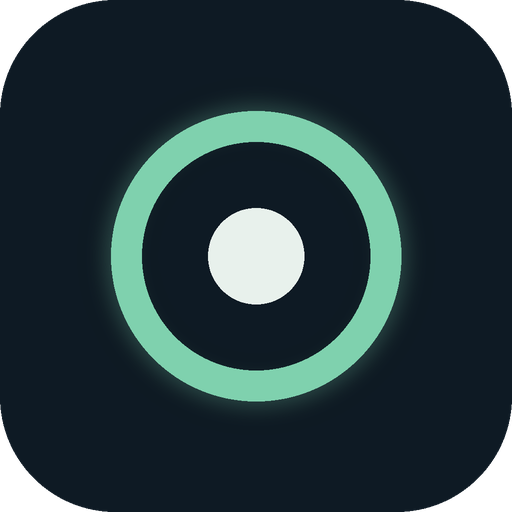

<div align="center">



# Study Mirror

**A focus companion that links your phone and your laptop, so studying blocks distractions instead of fighting them.**

[](https://github.com/YOUR-USERNAME/StudyMirror/releases/latest](https://github.com/SpynitterMina/Study-Mirror/releases/tag/v2.1.0))


[](LICENSE)

[Download](#-download) · [Install](#-installation) · [How it works](#-how-it-works) · [Features](#-features) · [Troubleshooting](#-troubleshooting)


</div>

---

## What is Study Mirror?

Study Mirror turns your study session into a series of focused **blocks** (for example 5 blocks of 50 minutes) separated by short **breaks**.

It has two parts that talk to each other over your home Wi-Fi:

| Part | Runs on | What it does |
|---|---|---|
| **Study Mirror (phone app)** | Android phone | Guards your phone during a focus block, counts distractions it stopped, and lets you park urges instead of acting on them. |
| **Study Mirror Control (desktop app)** | Windows laptop / PC | Your control center: start a block, take a break, see the timer, and read your stats and notes, without touching your phone. |

When you press **Start Block** on the laptop, your phone enters focus mode too. When the block ends, both switch to break together.

---

## ✨ Features

**Desktop control center**
- Big focus timer ring that turns **blue for focus** and **green for breaks**
- Block planner: set how many blocks you want today (up to 16) and jump between them
- Quick presets (25 / 50 / 90 minutes) or any custom length
- Optional "what am I working on" goal that shows on the timer and on your phone
- Chime when a block or break ends
- **Pin** (always on top) and **Mini mode**, a small floating timer that stays out of your way
- Stats from your phone: blocks completed, distractions cut, urges surfed, extensions used
- **Parked urge notes**: the thoughts you wrote down instead of acting on them
- Pair with your phone in seconds using a **QR code**
- Keyboard shortcuts for everything

**Phone link**
- Works over your local Wi-Fi, with no account and no cloud
- Live connection badge showing the phone state and response time
- Break time stays in sync if you extend it on the phone

### Keyboard shortcuts (desktop)

| Key | Action |
|---|---|
| `Space` | Start / pause the block |
| `[` and `]` | Previous / next block |
| `B` | Start a break |
| `M` | Toggle mini mode |
| `P` | Pin window on top |
| `Esc` | Close the side panel or pairing window |

---

## 📸 Screenshots

<table>
  <tr>
    <td align="center"><br><sub><b>Focus timer</b></sub></td>
    <td align="center"><br><sub><b>Break mode</b></sub></td>
    <td align="center"><br><sub><b>Mini mode</b></sub></td>
  </tr>
  <tr>
    <td align="center"><br><sub><b>Pair with QR code</b></sub></td>
    <td align="center"><br><sub><b>Stats and parked notes</b></sub></td>
    <td align="center"><br><sub><b>Phone in focus mode</b></sub></td>
  </tr>
</table>

---

## ⬇️ Download

Go to the **[Releases page](https://github.com/YOUR-USERNAME/StudyMirror/releases/latest)** and download both files from the latest version:

| For | File | Notes |
|---|---|---|
| 📱 Android phone | `StudyMirror.apk` | The phone app |
| 💻 Windows laptop / PC | `Study.Mirror.Control.2.1.0.exe` | Portable: no installer, just double-click |

> The exact file names may differ slightly on the release page. Download the `.apk` for the phone and the `.exe` for the laptop.

---

## 🛠 Installation

### 📱 On your phone (Android)

1. Open the **[Releases page](https://github.com/YOUR-USERNAME/StudyMirror/releases/latest)** on your phone and tap the `.apk` file to download it.
2. When the download finishes, tap **Open** (or open it from your *Downloads* folder).
3. Android will say it blocks installs from this source. Tap **Settings** and turn on **Allow from this source**, then go back.
4. Tap **Install**. If Play Protect shows a warning, tap **More details → Install anyway**. This appears because the app is not on the Play Store.
5. Open **Study Mirror** and grant the permissions it asks for.

### 💻 On your laptop (Windows)

1. Download `Study Mirror Control` (`.exe`) from the **[Releases page](https://github.com/YOUR-USERNAME/StudyMirror/releases/latest)**.
2. Put it anywhere you like, for example your Desktop.
3. Double-click it. If Windows SmartScreen says "Windows protected your PC", click **More info → Run anyway**.
4. When Windows asks about network access, choose **Private networks** and click **Allow**. This lets your phone talk to the laptop.

### 🔗 Pair the phone with the laptop (once)

1. Connect the phone and the laptop to the **same Wi-Fi** (not a guest network).
2. On the laptop, click the **Phone** badge at the top, then **Pair phone**. A QR code appears.
3. On the phone, open Study Mirror and tap **Scan the laptop QR**.
4. The badge on the laptop changes to **Phone (idle)** with a green dot. You are linked.

You can also pair by hand: open **Config → Phone Link** on the laptop, type the phone's IP address and the 6-digit pairing code shown in the phone app, then press **Test Connection**.

---

## 🚀 How it works

1. Set your block length, number of blocks, and (optionally) what you are working on.
2. Press **Start Block 1** on the laptop. The phone goes into focus mode.
3. Study. If an urge to scroll hits, park it as a note instead of acting on it.
4. When the timer ends, press **Break**. Both devices switch to break mode and the next block is selected for you.
5. Repeat until your blocks for the day are done, then check your stats in the side panel.

---

## 🧯 Troubleshooting

**The laptop says "Unreachable" or "Offline"**
- Make sure both devices are on the same Wi-Fi, not a guest network.
- On Windows, allow the app through the firewall: in the pairing window press **Allow in Windows Firewall**.
- Press **New code** in the pairing window and scan again.
- Test from the phone's browser: open the address shown in the pairing window. It should say `ok`.

**Some routers block devices from talking to each other**
- Turn on your phone's **hotspot**, connect the laptop to it, then press **New code** and pair again.

**The QR code does not scan inside the app**
- Use your normal camera or Google Lens, tap the link it shows, then tap **Open Study Mirror**.

**I do not want to install the desktop app**
- You can open `laptop/study-mirror-control.html` in a browser and pair manually through **Config → Phone Link**. QR pairing needs the desktop app.

---

## 👩‍💻 For developers

The desktop app is built with **Electron**.

```bash
git clone https://github.com/YOUR-USERNAME/StudyMirror.git
cd StudyMirror/desktop
npm install
npm start
```

Build the portable Windows `.exe`:

```bash
npx electron-builder --win portable
```

The result appears in `desktop/dist/`.

**Project layout**

```
StudyMirror/
├── desktop/      Electron desktop control center (main.js, index.html, build/)
├── laptop/       Single-file browser version of the control center
└── docs/         Screenshots used in this README
```

---

## 🤝 Contributing

Ideas and bug reports are welcome. Open an [issue](https://github.com/YOUR-USERNAME/StudyMirror/issues) and describe what you saw.

## 📄 License

Released under the MIT License. See [LICENSE](LICENSE).

---

<div align="center">
Built by <a href="https://github.com/YOUR-USERNAME">Mina</a> · If Study Mirror helps you focus, give it a ⭐
</div>
